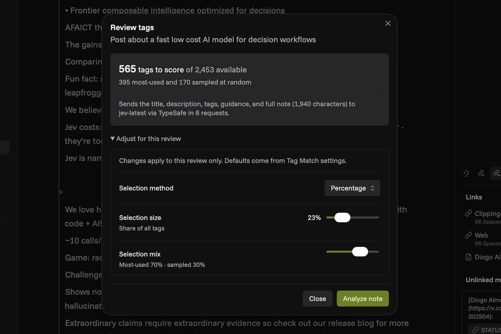
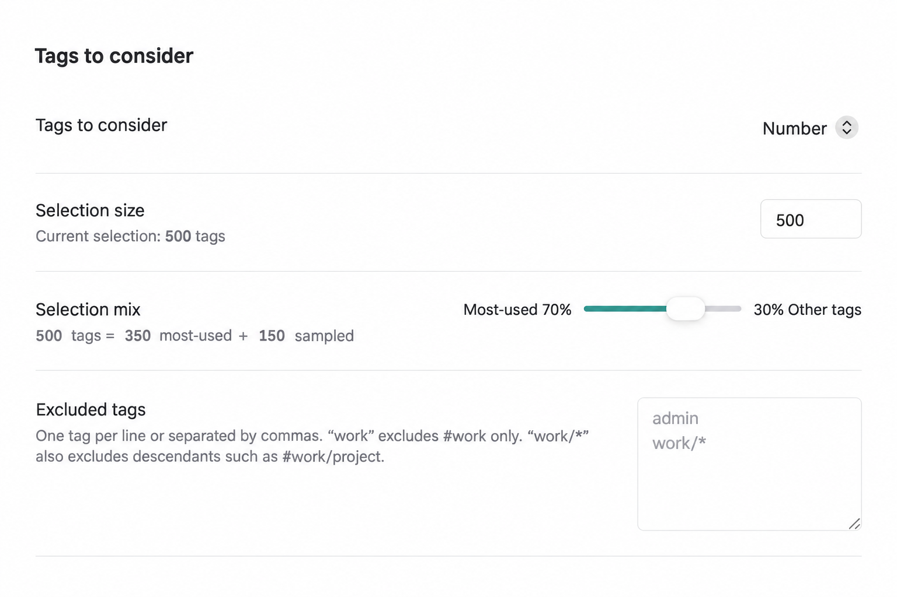
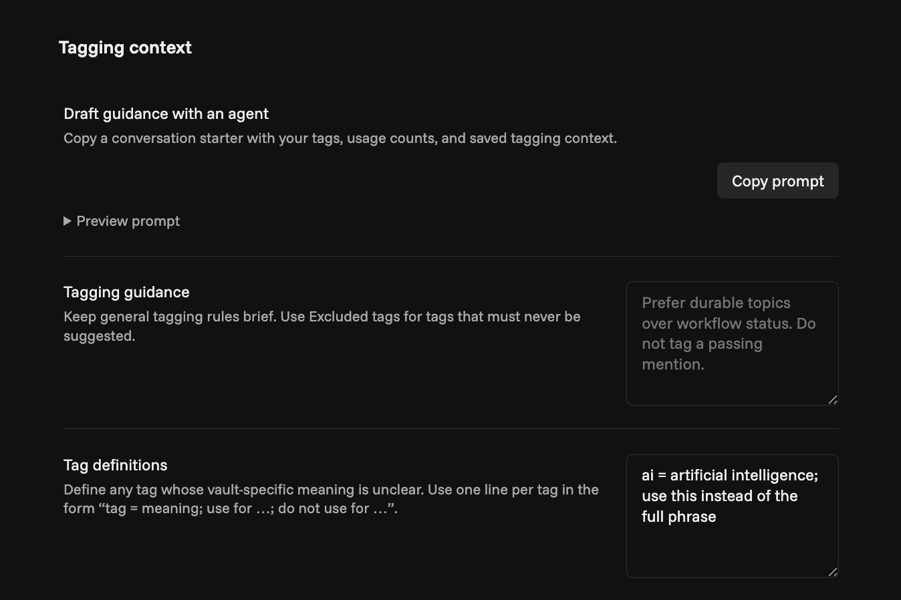

# Tag Match

Tag Match finds relevant tags for notes in your Obsidian vault. You can use existing vault tags or provide a specific set, including tags you haven't used yet.

You can review suggestions for an individual note or add matches directly to one note or a batch.

Generating tags note by note can lead to overlapping labels and a bloated tag vocabulary. Tag Match helps you maintain a consistent vocabulary by working from only existing or provided tags, leaving tag creation to you. The included assistant prompt helps you review their meanings and refine your tagging rules as your system evolves.

## Features

- **General and tag-specific guidance.** Give the model vault-wide rules and tag definitions, including when each tag should or shouldn't apply.
- **Fast, low-cost matching.** Decision models like Jev score tags independently against your note and guidance, so you can consider more of your vocabulary at low cost.
- **Configurable tag mix.** Balance your most-used tags with a sample of the rest, so newer and less-used tags get considered without checking your entire vocabulary.
- **Fine-grained controls.** Choose how many tags to check, exclude tags or branches, and set a minimum match score and add limit. Review matches or apply them without review.
- **Use existing tags or a specific set.** Reuse your vault's vocabulary or provide a list, including tags not yet used in the vault.
- **Bulk tagging.** Tag selected notes, folders, or both in the background, with batch-specific settings, progress tracking, results, and undo.
- **Fits existing agent workflows.** Agents can review or apply tags through the optional CLI using the plugin's provider settings, tagging rules, and tag definitions.

## Get started

You need Obsidian 1.13.0 or later and an account with [TypeSafe](https://typesafe.ai/), [OpenRouter](https://openrouter.ai/), or [OpenAI](https://developers.openai.com/api/docs/guides/decisions). Analysis requires an API key and paid credits with your chosen provider. Jev via TypeSafe is the default model.

To review tags for your first note:

1. [Install Tag Match from Community plugins](https://community.obsidian.md/plugins/tag-match). Enable it under **Settings → Community plugins**.
2. Open **Settings → Tag Match → Connection and agents**. Choose a **Connection provider** and keep its default model.
3. In the provider's API key field, create or select an Obsidian Secret containing your key. Enter the key on each device you use. Obsidian does not sync secret values.
4. Open a Markdown note. Run **Tag Match: Suggest tags for current note…** to open the review dialog.
5. Choose **Analyze note**. Select the suggested tags you want, then choose **Add tags** to apply them.



To add matches without reviewing them, run **Tag Match: Match and add tags to current note**. Both commands use your tag selection settings and refuse to apply results if the note has changed.

## Tag multiple notes

To apply tags to a batch:

1. Run **Tag Match: Match tags to multiple notes…**. You can also open the tag-matching action from the file explorer's context menu for selected files or folders.
2. Select notes or folders. Use **Show selected** to check the batch.
3. To override your defaults for this run, open **Adjust for this batch**.
4. Choose **Add tags to N notes** to analyze the batch and add matches without reviewing each note.

Use **Run in background** to keep working. Reopen progress through the notice, desktop status bar, or **Tag Match: Show bulk tagging progress** command.

**Stop** cancels remaining work. Requests already running may still use credits. Results show additions, skipped notes, and failures.

**Undo additions** restores notes that haven't changed since tagging. Undo remains available until you close completed results, reload the plugin, or quit Obsidian.

## Connection settings

Tag Match uses decision models to score each tag without generating prose. Under **Settings → Tag Match → Connection and agents**, each provider has its own API key and model fields. Switching providers preserves the other providers' settings.

To change models, enter a compatible model ID in the provider's **model** field. The link beside the field lists supported models.

| Connection provider | Default model | Compatible model IDs |
| --- | --- | --- |
| TypeSafe | `jev-latest` | [TypeSafe models and aliases](https://docs.typesafe.ai/models) |
| OpenRouter | `~typesafe/jev-latest` | [OpenRouter Jev latest alias](https://openrouter.ai/~typesafe/jev-latest) |
| OpenAI | `gpt-6-luna` | [OpenAI Decisions API models](https://developers.openai.com/api/docs/guides/decisions#how-decisions-work) |

OpenRouter routes requests to a hosting provider. Model availability also depends on your OpenRouter account's provider and privacy settings. General chat models are not supported by Tag Match's decision requests.

Model limits and response times differ. Large tag selections use multiple requests, processed in sequence for each note. Tag Match retries with smaller requests when it recognizes a provider's tag-count limit error. If analysis fails, Tag Match returns no partial suggestions for that note.

## How Tag Match chooses tags

### Vault tags

**Selection method** sets how many vault tags to consider. Choose the default, a specific number or percentage, or **All tags**. Considering more tags can find more matches, but can take longer and use more API credits.

When the selection is limited, **Selection mix** lets you balance your most-used tags with a sample of the rest. The sample varies between notes, giving less-used tags a chance without checking your entire vocabulary every time.

After a review, **Score more tags** draws another random sample of the same size from tags that haven't been scored yet.



### A specific set of tags

**Only these tags** in **Selection method** uses the tags you supply, including tags not yet used in the vault. It replaces vault selection and sampling, and ignores **Excluded tags**. Tags already on the note are skipped with either selection method.

### Exclusions and temporary settings

For vault tag selection, **Excluded tags** removes tags before analysis. For example, `admin` excludes that tag, and `work/*` excludes `work` and its descendants. Tagging guidance influences the model's judgment, while exclusions prevent the plugin from considering those tags.

**Adjust for this review** and **Adjust for this batch** override your saved settings for one run.

### Suggestions and tagging context

Tag Match chooses candidate tags locally, then asks the decision model to estimate the probability that each tag belongs on the note. The model receives the note's title, description, sampled body, and existing tags. It evaluates each candidate tag using your general guidance, any definition you supplied for that tag, and criteria for a meaningful match. Because tags are evaluated independently, several can qualify for the same note.

Tag Match ranks those probabilities. **Minimum match score** sets how strong a match must be, while **Maximum tags to add** limits how many are preselected for review or added directly. You can change the selection in review mode before adding tags.

Use short rules for general guidance, such as "Tag substantial topics. Skip passing mentions." Give individual tags a definition when your use differs from their ordinary meaning:

```text
dev = Building, debugging, or maintaining software. Include implementation tutorials. Exclude general technology news without development content.
```



Long notes are sampled from the beginning, middle, and end within your text limit. The review shows how many tags will be considered and whether the note was sampled before analysis.

## Agents and scripts

Agents can review or apply tags to one note or a batch through the optional Node CLI. It uses the plugin's saved provider, model, tagging preferences, and Obsidian Secret reference. The CLI reads the Secret while that vault is open in Obsidian. An environment variable can supply the key when Obsidian is closed.

To set up the CLI on desktop:

1. Choose **Copy install command** in Tag Match settings. Run the copied command in a terminal to install the CLI and agent guide beside the plugin without copying credentials.
2. Choose **Check CLI status** to confirm the installation.
3. Use **Copy agent instruction** to give your agent the installed guide's location.

Obsidian updates the plugin separately from the CLI. Tag Match offers a CLI update when the installed companion does not match the plugin.

The [agent guide](./docs/agent-cli.md) covers commands, bulk tagging and undo, credentials, and use without Obsidian.

## Install manually

To install without the community plugin browser:

1. Download `main.js`, `manifest.json`, and `styles.css` from the [latest release](https://github.com/nweii/tag-match/releases/latest).
2. Put the files in `<vault>/.obsidian/plugins/tag-match/`.
3. Reload Obsidian.
4. Enable Tag Match under **Settings → Community plugins**.

## Privacy and network access

Analysis sends the note title, description, existing tags, selected body text, candidate tags, tagging guidance, and relevant tag definitions to your chosen service: `api.typesafe.ai`, `openrouter.ai`, or `api.openai.com`. With OpenRouter, requests are routed to the model provider. Analysis starts only when you invoke it. There is no background vault scan sent to a model.

API keys stay in Obsidian Secrets on the device where you enter them. The plugin's `data.json` stores only the selected secret's name. Synced settings may carry that name to another device, but not the key. Tag Match has no client-side telemetry. Provider data handling follows [TypeSafe's privacy policy](https://typesafe.ai/legal/privacy-policy) and, when selected, [OpenRouter's privacy policy](https://openrouter.ai/privacy) or [OpenAI's API data policies](https://developers.openai.com/api/docs/guides/your-data).

Copy buttons write to the system clipboard only when clicked. Tag Match never reads it.

The Obsidian plugin operates within your vault. The optional CLI reads its explicit configuration path and can read or modify a Markdown file outside a vault when you supply that path. It does not search your filesystem for notes or credentials.

## About

Tag Match is an independent project by [Nathan Cheng](https://nathancheng.work/). It is not affiliated with Obsidian, TypeSafe, OpenRouter, or OpenAI.

[Report a bug](https://github.com/nweii/tag-match/issues/new/choose) · [Security policy](./SECURITY.md) · [Third-party notices](./THIRD_PARTY_NOTICES.md) · [Buy me a coffee](https://buymeacoffee.com/nthnwei)
